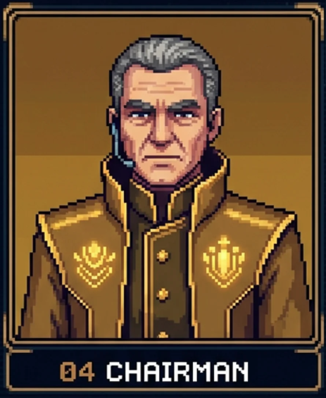

# Council

Claude Code skills for building an ecommerce funnel end to end, plus a 3-seat council that votes on every plan before you spend money on it.

## Skills
`ecom-research` → `ecom-avatar` → `ecom-angles` → `ecom-script` / `ecom-pages` → `ecom-media-buying`

Each uses your own playbook in `kb/` and saves results to `products/<store>/` only after you confirm.

## Council
| | Seat | Job |
|:-:|---|---|
|  | Builder | Makes the strongest version of the plan |
|  | Prosecutor | Tries to reject the plan entirely |
|  | Auditor | Checks every claim against your evidence |
|  | Chairman | Reports the verdict; doesn't vote |

Seats argue, rebut each other, then vote. A plan passes only with 2 of 3 votes. Missing evidence comes back as `NEEDS DATA`, never guessed.

Modes: `market`, `creative`, `performance`, `dev-ml`, `general`.

## Install
```sh
git clone https://github.com/zahiraIi/council ~/council && ~/council/scripts/install.sh
```
Fill `kb/` (copied from `kb.example/`) with your own rules, then in Claude Code:
```
/council market: <your thesis>   (attach Google Trends / ad library screenshots)
```

`kb/`, `products/` and `_sources/` stay private (git-ignored).
