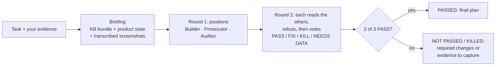

# Council

**Claude Code skills that take an ecommerce brand from product idea to scaling ads, with a 3-seat council that votes on every decision before you spend money on it.**

[](https://github.com/zahiraIi/council/actions/workflows/ci.yml)

## Why
One model gives one confident answer: it fills gaps with invented numbers, agrees with your plan, and forgets your rules. This project fixes that with plain files and a few hard rules, no infrastructure:
- **Your playbook, not the model's memory.** Rules live in `kb/` (your own knowledge base). Each task loads only the 3–6 files it needs.
- **Your evidence, not guesses.** Market claims (Google Trends, demand, competition, ad metrics) come from screenshots and numbers you bring. Missing evidence is reported as `NEEDS DATA: <what to capture>`, never estimated.
- **A vote before you commit.** A plan passes only if a majority of the council votes for it.

## The funnel
```
ecom-research → ecom-avatar → ecom-angles → ecom-script / ecom-pages → ecom-media-buying
     │               │              │                  │                         │
  /council market  market         market            creative                performance
```
Each skill does the work step by step and saves the result to `products/<store>/` (product facts, avatars, angles, offers, creatives, a dated log), only after you confirm. At each arrow, `/council <mode>:` votes on the output.

## The council
| | Seat | Job |
|:-:|---|---|
|  | **Builder** | Makes the strongest version of the plan: drafts it, or defends and amends yours |
|  | **Prosecutor** | Tries to get the plan rejected entirely, and says what evidence would change its mind |
|  | **Auditor** | Neutral: checks every claim against your evidence and the KB, flags anything invented |
|  | **Chairman** | Doesn't vote: reports the tally, pros and cons, and required fixes. Can't override the vote |


Votes come after a rebuttal round, so seats can change sides: the Prosecutor must vote PASS if its objections were answered, and the Builder must vote FIX or KILL if an objection is fatal. Without that round, the Auditor would decide every vote alone.

**Modes** (`skills/council/modes/`):
- `market`: is this product, sub-avatar, angle or offer worth betting on? Judged on your Trends, demand, competition and economics evidence.
- `creative`: scripts, ad copy, advertorials, listicles, PDPs. The Prosecutor plays the skeptical customer; the Auditor scores the KB rubric line by line.
- `performance`: kill/scale decisions and store audits, from your Ads Manager and Shopify numbers.
- `dev-ml` and `general`: the same vote for code, ML and anything else.

One council run is 7 subagent calls.

## Quick start
```sh
git clone https://github.com/zahiraIi/council ~/council && ~/council/scripts/install.sh
```
`install.sh` symlinks the skills into Claude Code and copies `kb.example/` to `kb/`. Then fill `kb/` with your own playbook: rules as bullets, each tagged with its source. Run `uv run --no-project --with pyyaml python scripts/check_kb.py` (or plain `python` with PyYAML installed) to confirm everything is routed and parses.

In Claude Code:
```
/ecom-research  I'm looking at <product>          # get the evidence checklist
/council market: <thesis>  [attach Trends / ad library screenshots]
/ecom-script    write a script for angle A2
/council creative: <paste the script>
```

## What we measured
- **Council vs. a single model** on 20 seeded-bug code tasks (`evals/council_vs_single/`): Opus and Sonnet alone scored 100% at about $0.04–0.08 per task. The earlier 4-member council matched that on its pilot task at about 12× the cost and 25× the latency. Objective tasks at the ceiling leave no room for a council to help, so the council is meant for judgment calls, not lookups.
- **Retrieval infrastructure was tried and removed.** An earlier version searched the KB through a hybrid keyword + embedding knowledge graph (SQLite FTS5, Ollama, an MCP server). On a 20-task benchmark, the hand-written task bundles already contained 100% of the rules each task needed at about 4,200 tokens, and adding graph search found nothing extra. It made setup five steps longer without reducing hallucination, so it's gone (see git history).

## Repo layout
```
skills/council/   the council: SKILL.md (rounds, vote, tally) + modes/*.md (seat focus, evidence checklist, rubric)
skills/ecom-*/    step-by-step skills: research, avatar, angles, script, pages, media-buying
skills/protocol.md  shared rules: load context, evidence, no invention, write-back with consent
kb.example/       knowledge-base template (structure + routing, no content); install.sh copies it to kb/
products/_template/  per-store state files
scripts/          install.sh, check_kb.py
evals/            council_vs_single: seeded-bug tasks + runner (headless `claude -p`)
```

## Limitations
- All seats are Claude models and can share blind spots. Your own evidence and the Auditor's checks are the guard against that.
- The council is only as good as `kb/` and the evidence you bring. With an empty KB it falls back to general knowledge and says so.
- Live-store features need the Shopify MCP connector in Claude Code.

## Data
`kb/`, `products/<store>/` and `_sources/` are git-ignored: your playbook, store data and source material stay on your machine.
