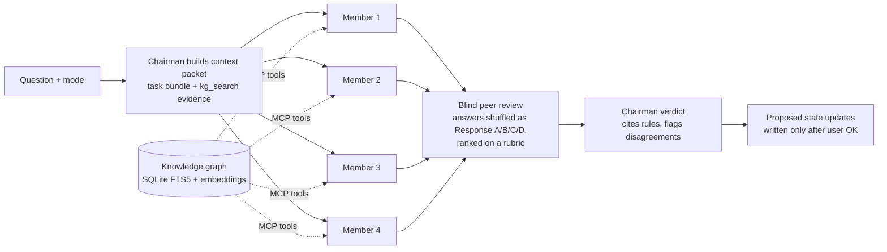

# Council

**A panel of AI agents that debate a question, anonymously grade each other, and hand back one verdict, grounded in a searchable knowledge graph instead of the model's memory.**

Built on Claude Code. It applies the [LLM Council](https://github.com/karpathy/llm-council) idea to real work: running an ecommerce brand (ad scripts, offers, landing pages, ad-budget decisions) and reviewing code.

[](https://github.com/zahiraIi/council/actions/workflows/ci.yml)

## In 30 seconds

| | |
|---|---|
| **Problem** | One model gives one confident answer, and it often invents rules or quietly uses outdated advice. Pasting a whole knowledge base into every prompt is slow and expensive. |
| **What it does** | 1. Four agents with different roles (e.g. *copywriter*, *skeptical customer*, *media buyer*) answer independently.<br>2. They rank each other's answers blind, against a task-specific rubric.<br>3. A chairman writes the final verdict.<br>4. Every agent can search a **local knowledge graph** over an MCP server and must cite what it uses. |
| **Built with** | Python · SQLite FTS5 · Ollama (`nomic-embed-text`) · Model Context Protocol (MCP) · Claude Code subagents · pytest · GitHub Actions |
| **Skills shown** | Agentic orchestration · tool calling · RAG with hybrid search · MCP server (stdlib JSON-RPC) · retrieval evals on a held-out set · context-cost benchmarking · observability (JSONL traces) · CI |

## Results

All numbers come from scripts in this repo. Rerun them with the commands under *Reproduce* below.

**Retrieval quality**: does search return the right rule? (`kg/scripts/eval_search.py`)
- Settings were tuned on 31 queries.
- The headline numbers are on **26 held-out queries written after tuning was frozen**.

| Search mode | Held-out hit@1 | Held-out hit@5 |
|---|---:|---:|
| Keyword only (SQLite FTS5) | 0.50 | 0.85 |
| **Hybrid: keyword + local embeddings, rank fusion** | **0.62** | **0.88** |
| Hybrid, KB-only cases on a KB-only index (public clone, no private sources) | 0.64 | 0.91 |

**Context cost**: how much text an agent must read per task (`kg/scripts/bench_context.py`, 20 tasks).

| Strategy | Avg tokens | vs. whole KB | Needed rules present |
|---|---:|---:|---:|
| Paste the whole knowledge base | 27,288 | — | 100% |
| Hand-written task bundles | 4,199 | **−85%** | 100% |
| Graph retrieval only (top-8) | 2,797 | −90% | 85% |
| **Bundles + graph evidence (what the council uses)** | 4,761 | **−83%** | **100%** |

> Takeaway: retrieval alone saves the most tokens but misses 15% of needed rules. A curated baseline plus retrieved evidence keeps every needed rule at about 1/6 of the full context.

**Council vs. a single model**: seeded-bug code review, scored by exact line number (`evals/council_vs_single/`).

| Task set | Condition | Tasks | Accuracy | Typical cost / task (API-equiv.) | Avg latency |
|---|---|---:|---:|---:|---:|
| Basic (12 bugs) | Opus alone | 12 | 100% | ~$0.08 | 5 s |
| Basic | Sonnet alone | 12 | 100% | ~$0.04 | 4 s |
| Hard (8 bugs, cross-function / docstring-contract) | Opus alone | 8 | 100% | ~$0.08 | 7 s |
| Hard | Sonnet alone | 8 | 100% | ~$0.04 | 5 s |
| Basic (pilot) | **Council** (4 members + review + chairman) | 1 | 100% | ~$1.02 | 151 s |

> **Negative result, reported as-is.** On objective bug-finding, single frontier models already score at the ceiling, so the council has no room to be more accurate. It costs about **12× more** and is about **25× slower** per task. The council's value has to be shown on tasks where single models disagree or fail (judgment calls, longer codebases), not on tasks like these.
>
> Method notes:
> - The first call of each condition includes a one-time prompt-cache write (about $0.6–1.2), so typical cost excludes it.
> - One hard-task answer key was widened after review: both models diagnosed the bug correctly but placed the fix one line later.
> - An early council pilot skipped the debate and answered directly. The runner now forces the full council (`[full council]`) and rejects runs that don't convene.

## Meet the council

Each run seats four members. Which roles sit depends on the task, and the **Chairman** always presides. *(Character art: drop your images into `assets/council/` with the same filenames.)*

| | Role | What they push on |
|:-:|---|---|
|  | **Chairman** | Weighs the peer rankings and writes the final verdict |
|  | **Copywriter** | Writes and rewrites hooks, scripts, page copy |
|  | **Creative Strategist** | Angles, story ideas, which customer to target |
|  | **The Avatar** | Plays the skeptical customer: "would I stop, believe, buy?" |
|  | **Media Buyer** | Can it be tested, does it match the ad, latest kill/scale rules |
|  | **Aggressive Scaler** | Opportunity cost, big swings |
|  | **Data Analyst** | Signal vs. noise at this spend level |
|  | **Funnel / CRO** | Is it the creative, the offer, or the page? |
|  | **Script Auditor** | Line-by-line rubric check |
|  | **Skeptic** | Believability, saturation, risk |
|  | **Customer Researcher** | Patterns in real customer quotes |
|  | **Market Sizer** | Market size and desire strength |
|  | **Integrity Editor** | No invented claims, compliance |
|  | **Offer Strategist** | Bundles, pricing, framing |
|  | **CFO** | Unit economics, break-even |
|  | **Product Researcher** | Opportunity and novelty |
|  | **Tracking Analyst** | Pixel, attribution, ad↔page congruence |
|  | **Implementer** *(code)* | Pragmatic fix matching the codebase |
|  | **Reviewer** *(code)* | Bugs, edge cases, leakage |
|  | **Researcher** *(code)* | Known baselines, prior work |
|  | **Systems Engineer** *(code)* | Cost, memory, simplicity |

Modes and their seats: `script`, `copy`, `angles`, `avatar`, `page`, `offer`, `store-audit`, `research`, `media-buying`, `dev-ml`, `general` (see `skills/council/modes/`).

## How it works



**The knowledge graph** (`kg/`, modeled on [ATLAS](https://github.com/zainkhatri/knowledge-graph)):
- **Nodes** (~1,000): curated rules (sections of `kb/`), reference entries, and raw source chunks (call summaries, course docs, a book) with page ranges, plus concepts.
- **Edges**:
  - `cites`: a rule points to its source.
  - `supersedes`: an old source is marked outdated when a newer call changed the advice, so agents don't use stale rules.
  - `mentions`: rule or chunk → concept.
  - `in_bundle`: file → task bundle.
  - `follows`: chronology of calls.
- **Search**: three tiers fused with reciprocal-rank fusion:
  1. exact keyword match
  2. at least two words in common
  3. semantic similarity from local Ollama embeddings
- **Gate**: an off-topic gate returns nothing rather than noise.
- **If Ollama is down**, search falls back to keywords only.
- **MCP tools**: `kg_search`, `kg_get`, `kg_neighbors`, `kg_sources` (resolve a citation tag), `kg_stat`. Every call is traced to JSONL; `kg trace` summarizes latency and the zero-result rate.

## Quick start

```sh
git clone https://github.com/zahiraIi/council ~/council && ~/council/scripts/install.sh
```
`install.sh` links the skills into Claude Code and registers the `council-kg` MCP server. Then:
```sh
brew install ollama && brew services start ollama && ollama pull nomic-embed-text   # local embeddings
cd ~/council/kg && uv sync && uv run kg build                                       # build the graph
```
In Claude Code: `/council media-buying: ad set at 1.3x break-even ROAS after 3 days, scale now?`

## Reproduce

```sh
cd kg && uv run pytest                              # 21 unit + repo-integrity tests (also run in CI)
uv run python scripts/eval_search.py                # retrieval: tune vs held-out hit@1/hit@5
uv run python scripts/bench_context.py --k 8        # context tokens per strategy
cd .. && uv run --project kg python evals/council_vs_single/run.py --report
uv run kg trace                                     # MCP call latency / zero-result rate
```

## Repo layout

```
skills/council/   the council: SKILL.md (orchestration) + modes/*.md (roles, rubric, output format per task)
skills/ecom-*/    step-by-step skills: research, avatar, angles, script, pages, media-buying
kb/               curated knowledge base (~27k tokens); kb/index.yaml routes each task to 3-6 files
kg/               knowledge graph: councilkg/ (indexer, store, hybrid search, tracing), mcp_server.py,
                  tests/, scripts/ (eval_search.py, bench_context.py), results/
evals/            council_vs_single/: seeded-bug tasks + runner (headless `claude -p`)
assets/council/   character art for each council role
AGENTS.md         entry point for any agent (Codex, Cursor, Gemini CLI); CLAUDE.md points here
```

## Honest limitations
- **All four seats are Claude models** (Opus, Sonnet, Haiku, Fable). Anonymous review reduces self-preference but can't remove it, and the members share blind spots. A cross-vendor or local seat is the next experiment.
- **Retrieval is good but not perfect**:
  - The off-topic gate occasionally blocks a valid paraphrase. For example, "can I make up testimonials" returns nothing.
  - One off-topic control still leaks results.
- **Token counts use tiktoken `cl100k_base` as a proxy for Claude's tokenizer.** The ratios between strategies are what matter.

## Data and licensing
- The private store state (`products/<store>/`) is git-ignored and never committed.
- So are the original course material and books (`_sources/`).
- `kb/` is a condensed set of notes derived from a paid course.
